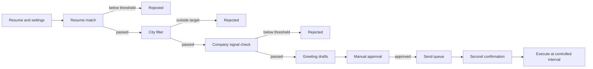

# Architecture

## Goals

The extension keeps the expensive decision points deterministic and local:

1. Match the resume to a job.
2. Keep only jobs in configured cities.
3. Assess page-level company signals.
4. Generate editable greeting options.
5. Require explicit job approval.
6. Require a second confirmation before queue execution.

## Layers

### Domain

`src/shared` contains pure TypeScript functions for matching, city filtering,
company signals, greeting generation, approval, and execution limits. These
modules do not access browser APIs and are covered by Vitest.

### Browser adapter

`src/entrypoints/content` reads and acts on the active Boss page. Selectors and
DOM heuristics are isolated in `adapter.ts`. When the platform changes its page
structure, this layer should be updated first.

### Extension UI

`src/entrypoints/sidepanel` renders the four-step workflow. UI state is stored
with `browser.storage.local`; no remote backend is used in version 0.1.0.

### Lifecycle

`src/entrypoints/background.ts` configures the toolbar button to open the side
panel. It does not run the send queue, so closing the side panel stops an
in-progress queue instead of leaving an unsupervised background sender.

## Data flow

## Security invariants

- `approvedQueue` excludes jobs without explicit approval.
- `canExecuteQueue` requires both an approved item and a second confirmation.
- A verification page is checked before and after browser actions.
- A queue stops on the first blocked, manual-intervention, or failed result.
- Daily limits count only successful sends for the current local day.
- The project never requests or stores a Boss password or session cookie.

## Company assessment boundary

The company score combines page completeness, size, financing, description
quality, and known risk phrases. It is a triage signal, not a factual
certification. Every risky or incomplete company includes links for manual
verification with public registries and business-information services.

## Page adapter strategy

The adapter prioritizes stable concepts over one brittle selector:

- job links containing `/job_detail/`
- classes containing `job-name`, `salary`, `company-name`, and `job-area`
- visible communication and send controls by accessible text
- conservative stop behavior when a required control is missing

Changes to Boss markup should be added to the adapter tests with a small,
privacy-safe fixture. Live account data must never be committed as a fixture.
