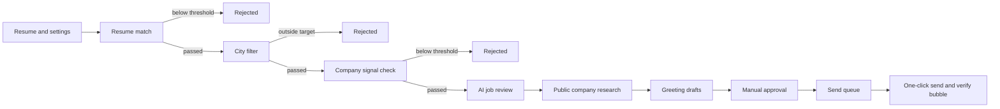

# Architecture

## Goals

The extension keeps the expensive decision points deterministic and local:

1. Match the resume to a job.
2. Keep only jobs in configured cities.
3. Assess recruitment-page company signals.
4. Optionally verify public company information through search and an AI provider.
5. Generate editable greeting options.
6. Require explicit job approval.
7. Execute the approved queue with one click in a background job tab.
8. Confirm a new complete message bubble before marking a send successful.

## Layers

### Domain

`src/shared` contains pure TypeScript functions for matching, city filtering,
company signals, AI response validation, company evidence mapping, greeting
generation, approval, queue transitions, backups, and execution limits. These
modules avoid browser APIs where possible and are covered by Vitest.

### Browser adapter

`src/entrypoints/content` reads and acts on the active Boss page. Selectors and
DOM heuristics are isolated in `adapter.ts`. Infinite-scroll batches can open each
visible job card, read the right-side detail panel, and merge the full JD before
domain matching. When the platform changes its page structure, this layer should
be updated first.

### Extension UI

`src/entrypoints/sidepanel` renders the four-step workflow. UI state is stored
with `browser.storage.local`; no remote backend is used.

### Lifecycle

`src/entrypoints/background.ts` configures the toolbar button and a five-minute
unread-reply alarm. It does not run the send queue, so closing the side panel
stops an in-progress queue instead of leaving an unsupervised background sender.

## Data flow

## Security invariants

- `approvedQueue` excludes jobs without explicit approval.
- `canExecuteQueue` requires at least one explicitly approved item.
- A verification page is checked before and after browser actions.
- A queue only starts jobs in the `idle` state.
- A send succeeds only after a new matching message bubble is observed.
- A queue continues after ordinary failed, unverified, manual-intervention, or
  missing-job results and records those jobs in the failure-and-attention list.
- At the per-job result level, a queue stops only for a blocked verification,
  login, or security state. Daily limits and unrecoverable browser setup errors
  also stop execution.
- Failed and interrupted jobs require explicit recovery before another attempt.
- Daily limits count only successful sends for the current local day.
- The project never requests or stores a Boss password or session cookie.
- The message list is never acted on with synthesized row clicks. Boss may treat
  those as invalid and reload the whole page; approved chats are opened through
  the exact `chat?id=...` URL returned by Boss.

## Company assessment boundary

The local company score combines page completeness, size, financing, description
quality, and known risk phrases. When configured, Tavily searches public
information and an AI model evaluates only the returned evidence. The UI
preserves the actual source URLs. This remains a triage signal, not a factual or
legal certification.

## Page adapter strategy

The adapter prioritizes stable concepts over one brittle selector:

- job links containing `/job_detail/`
- classes containing `job-name`, `salary`, `company-name`, and `job-area`
- visible communication and send controls by accessible text
- explicit Boss conversation URLs containing `chat?id=...`
- stable chat composer and send-button classes after the conversation is loaded
- conservative stop behavior when a required control is missing

Changes to Boss markup should be added to the adapter tests with a small,
privacy-safe fixture. Live account data must never be committed as a fixture.
